# BUKU PANDUAN PENGGUNA (USER MANUAL BOOK)
## SISTEM MANAJEMEN INVENTARIS & FASILITAS RUANGAN KANTOR
**Edisi:** Versi 2.0 (Web Edition - On-Premise LAN)  
**Kategori:** Dokumen Teknis & Operasional Kuliah Kerja Praktik (KKP)  
**Tahun:** 2026  

---

## DAFTAR ISI
1. [BAB I: Pendahuluan & Cara Akses Jaringan LAN Kantor](#bab-i-pendahuluan--cara-akses-jaringan-lan-kantor)
2. [BAB II: Hak Akses Berbasis Grup Divisi (Group RBAC)](#bab-ii-hak-akses-berbasis-grup-divisi-group-rbac)
   - 2.1 [List Akses Divisi](#21-list-akses-divisi)
   - 2.2 [Form Matrix Hak Akses (2 Kolom Menu & Submenu)](#22-form-matrix-hak-akses-2-kolom-menu--submenu)
3. [BAB III: Manajemen Pengguna & Penugasan Divisi](#bab-iii-manajemen-pengguna--penugasan-divisi)
   - 3.1 [Daftar Pengguna Kantor](#31-daftar-pengguna-kantor)
   - 3.2 [Tambah User Baru & Pewarisan Grup Otomatis](#32-tambah-user-baru--pewarisan-grup-otomatis)
4. [BAB IV: Dashboard Utama & Monitoring Real-Time](#bab-iv-dashboard-utama--monitoring-real-time)
5. [BAB V: Pengelolaan Master Data Inventaris](#bab-v-pengelolaan-master-data-inventaris)
   - 5.1 [Data Aset & Barcode](#51-data-aset--barcode)
   - 5.2 [Kategori Barang](#52-kategori-barang)
   - 5.3 [Ruang Pertemuan / Rapat](#53-ruang-pertemuan--rapat)
   - 5.4 [Lokasi Penyimpanan](#54-lokasi-penyimpanan)
   - 5.5 [Status Inventaris](#55-status-inventaris)
   - 5.6 [Supplier / Vendor](#56-supplier--vendor)
6. [BAB VI: Operasional & Transaksi Sirkulasi](#bab-vi-operasional--transaksi-sirkulasi)
   - 6.1 [Peminjaman Aset & Pengembalian](#61-peminjaman-aset--pengembalian)
   - 6.2 [Pengeluaran Barang Habis Pakai (Outbound)](#62-pengeluaran-barang-habis-pakai-outbound)
   - 6.3 [Booking Ruang Rapat Anti-Bentrok](#63-booking-ruang-rapat-anti-bentrok)
   - 6.4 [Stock Opname (Audit Fisik Berkala)](#64-stock-opname-audit-fisik-berkala)
7. [BAB VII: Pelaporan, Ekspor Excel & Cetak Dokumen Resmi](#bab-vii-pelaporan-ekspor-excel--cetak-dokumen-resmi)
8. [BAB VIII: Tanya Jawab (FAQ) & Panduan Troubleshooting](#bab-viii-tanya-jawab-faq--panduan-troubleshooting)

---

## BAB I: PENDAHULUAN & CARA AKSES JARINGAN LAN KANTOR

Sistem Manajemen Inventaris & Fasilitas Kantor merupakan sistem terpusat berbasis web yang di-hosting pada server lokal di dalam lingkungan kantor (On-Premise LAN). Seluruh staf dapat mengakses aplikasi ini menggunakan web browser standar (Google Chrome, Microsoft Edge, Mozilla Firefox) tanpa perlu menginstal aplikasi tambahan di setiap komputer klien.

### Cara Mengakses Aplikasi di Kantor
Buka browser pada komputer kerja Anda yang terhubung ke jaringan WiFi atau kabel LAN kantor, lalu ketikkan alamat IP server kantor:
- Dari Komputer Klien (Karyawan): `http://192.168.1.15:3000`
- Dari Komputer Server: `http://localhost:3000`

---

## BAB II: HAK AKSES BERBASIS GRUP DIVISI (GROUP RBAC)

Sistem menerapkan konsep **Group Permission** pada level divisi kerja. Administrator tidak perlu mengatur hak akses satu per satu per pegawai. Izin menu & submenu dikonfigurasikan pada tingkat **Divisi & Level**, sehingga setiap akun baru yang dibuat otomatis mewarisi seluruh izin aksesnya.

### 2.1 List Akses Divisi
Navigasikan ke menu **Akses & Pengguna &rarr; List Akses (Divisi)**. Halaman ini menyajikan tabel seluruh divisi kantor beserta level jabatannya.

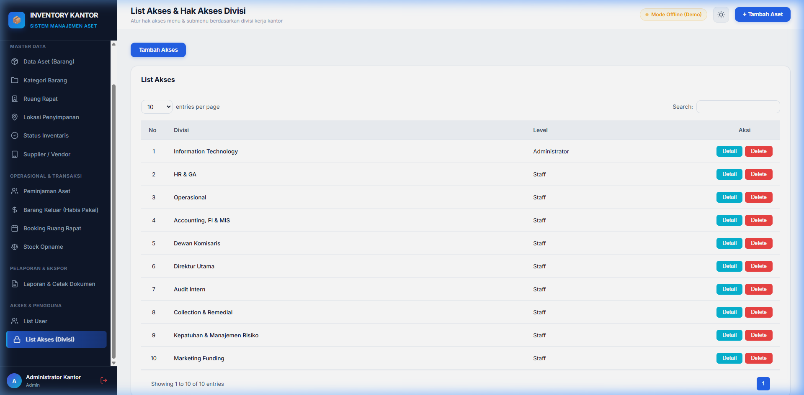
*Gambar 2.1: Layar List Akses Divisi dengan tombol Detail (teal) dan Delete (merah).*

#### Langkah Penggunaan:
1. **Pencarian Divisi:** Ketikkan nama divisi pada kolom `Search` di kanan atas.
2. **Paginasi Baris:** Pilih jumlah baris per halaman (10, 25, 50 entri).
3. **Mengatur Hak Akses:** Klik tombol **Detail** (warna *teal*) pada divisi yang ingin diatur permission-nya.
4. **Menambah Divisi Baru:** Klik tombol **+ Tambah Akses** di atas tabel.

---

### 2.2 Form Matrix Hak Akses (2 Kolom Menu & Submenu)
Ketika tombol **Detail** diklik, sistem membuka form matriks perizinan dua kolom:

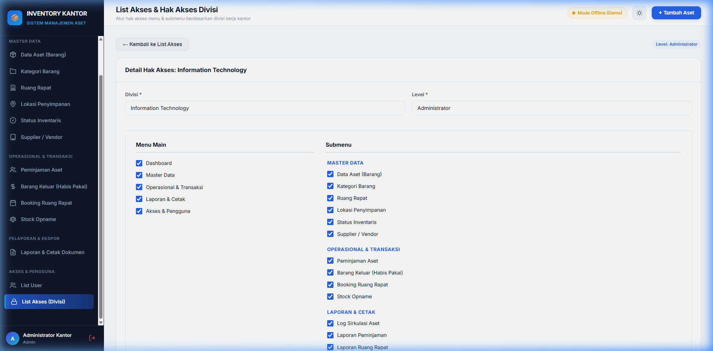
*Gambar 2.2: Form Matrix Hak Akses: Kolom Kiri (Menu Main) dan Kolom Kanan (Submenu).*

#### Aturan Konfigurasi:
- **Kolom Kiri (Menu Main):** Menentukan visibilitas modul utama pada sidebar (Dashboard, Master Data, Operasional, Laporan, Akses).
- **Kolom Kanan (Submenu):** Menentukan hak akses ke sub-fitur spesifik (Data Aset, Ruangan, Peminjaman, Booking, List User, dll.).
- **Tombol Pintas:**
  - `Pilih Semua`: Mengaktifkan seluruh hak akses (mode Administrator).
  - `Batal Semua`: Mengosongkan seluruh centang permission.
- **Simpan:** Klik **💾 Simpan Pengaturan Akses**. Seluruh staf pada divisi tersebut otomatis terupdate hak aksesnya.

---

## BAB III: MANAJEMEN PENGGUNA & PENUGASAN DIVISI

### 3.1 Daftar Pengguna Kantor
Buka menu **Akses & Pengguna &rarr; List User** untuk melihat seluruh pegawai yang memiliki akun sistem.

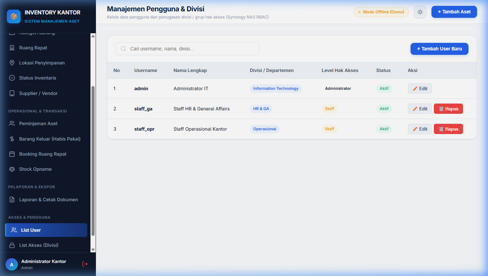
*Gambar 3.1: Tabel Manajemen Pengguna dengan status akun dan grup divisi.*

---

### 3.2 Tambah User Baru & Pewarisan Grup Otomatis
Klik tombol **+ Tambah User Baru** pada sudut kanan atas tabel user.

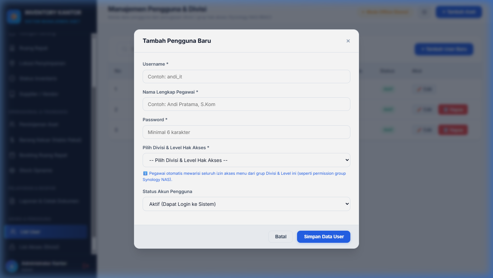
*Gambar 3.2: Modal Tambah Pengguna Baru dengan pilihan Divisi & Level.*

#### Langkah Pengisian:
1. **Username:** Masukkan username unik tanpa spasi (contoh: `andi_it`, `staff_ga`).
2. **Nama Lengkap:** Masukkan nama lengkap pegawai beserta gelar.
3. **Password:** Masukkan kata sandi akun (minimal 6 karakter).
4. **Pilih Divisi & Level Hak Akses:** Pilih grup kerja (misal: *HR & GA - Staff*). Pegawai otomatis mewarisi seluruh menu yang diizinkan untuk grup tersebut.
5. **Status Akun:** Pilih `Aktif`.
6. Klik **Simpan Data User**.

---

## BAB IV: DASHBOARD UTAMA & MONITORING REAL-TIME

Halaman beranda aplikasi menyajikan informasi ringkasan eksekutif dan status operasional terkini:

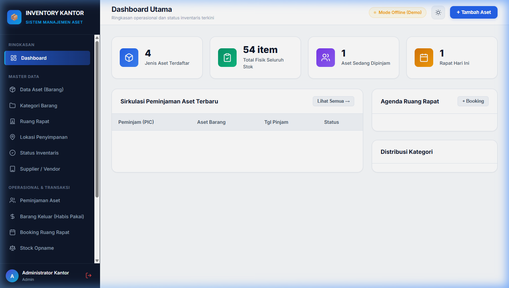
*Gambar 4.1: Dashboard Utama Real-Time.*

### Komponen Dashboard:
1. **Kartu KPI:**
   - **Jenis Aset Terdaftar:** Jumlah ragam barang yang tercatat.
   - **Total Fisik Seluruh Stok:** Total kuantitas barang fisik yang ada di kantor.
   - **Aset Sedang Dipinjam:** Jumlah barang yang sedang berada di tangan pegawai peminjam.
   - **Rapat Hari Ini:** Jumlah pemesanan ruang rapat yang dijadwalkan pada hari ini.
2. **Sirkulasi Peminjaman Terbaru:** Tabel 5 transaksi peminjaman aset terakhir.
3. **Agenda Ruang Rapat:** Daftar jadwal meeting hari ini beserta nama penanggung jawab (PIC).
4. **Distribusi Kategori:** Diagram visual persentase jenis aset kantor.

---

## BAB V: PENGELOLAAN MASTER DATA INVENTARIS

### 5.1 Data Aset & Barcode
Buka menu **Master Data &rarr; Data Aset (Barang)**. Menampilkan seluruh inventaris barang kantor.

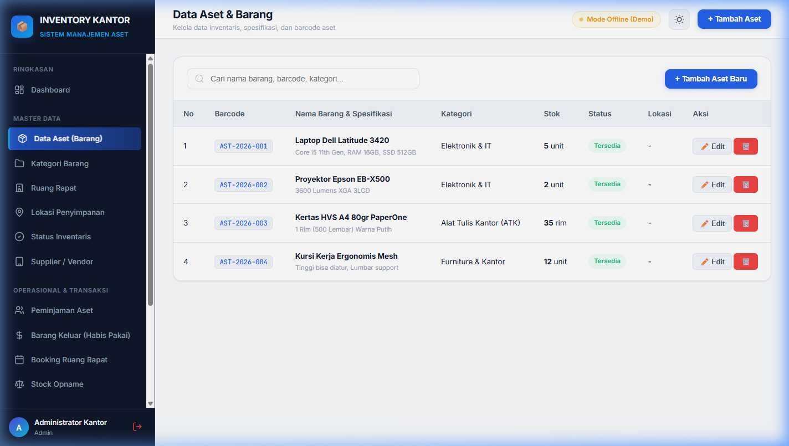
*Gambar 5.1: Tabel Katalog Master Data Aset.*

Klik **+ Tambah Aset** untuk menambahkan barang baru ke dalam sistem:

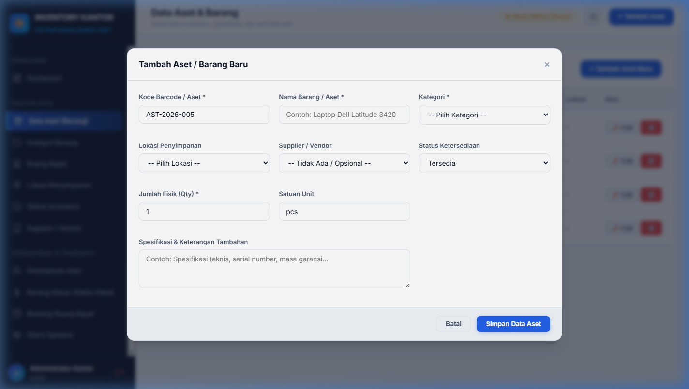
*Gambar 5.2: Form Input Aset Baru lengkap dengan Barcode dan Spesifikasi.*

---

### 5.2 Kategori Barang
Buka menu **Master Data &rarr; Kategori Barang**. Membedakan barang menjadi dua klasifikasi:
- **ASET:** Barang inventaris berwujud tahan lama (Laptop, Proyektor, AC, Kursi).
- **CONSUMABLE:** Barang habis pakai (Kertas HVS, Tinta Printer, Baterai, Spidol).

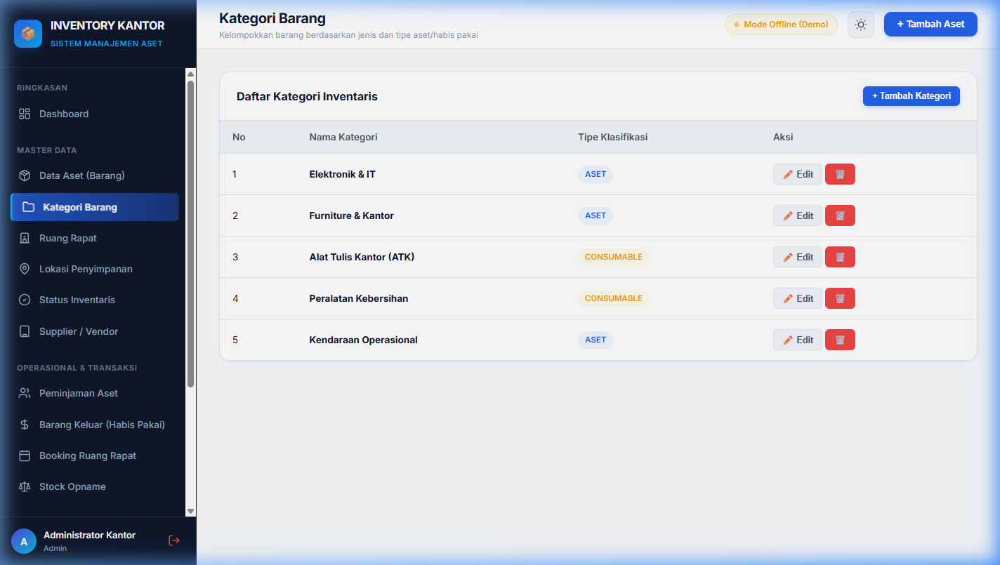
*Gambar 5.3: Master Kategori Barang.*

---

### 5.3 Ruang Pertemuan / Rapat
Buka menu **Master Data &rarr; Ruang Rapat**. Mendata ruangan rapat kantor yang siap dipakai untuk rapat koordinasi dinas.

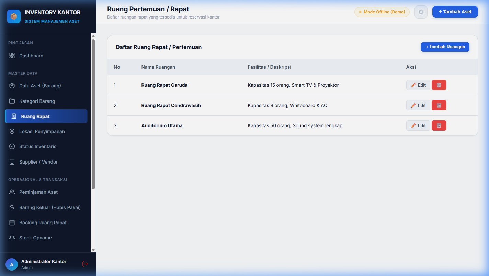
*Gambar 5.4: Master Ruang Rapat Kantor.*

---

### 5.4 Lokasi Penyimpanan
Buka menu **Master Data &rarr; Lokasi Penyimpanan**. Mendata gedung, lantai, dan ruangan tempat penyimpanan aset.

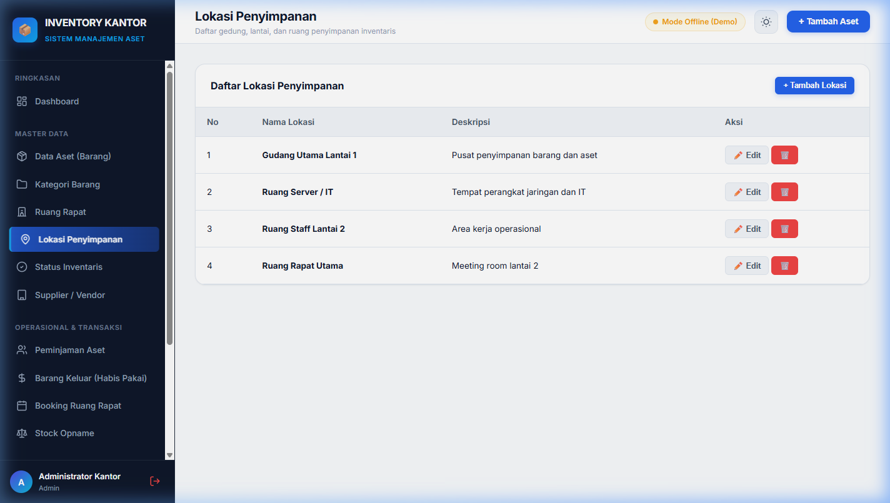
*Gambar 5.5: Master Lokasi Penyimpanan.*

---

### 5.5 Status Inventaris
Buka menu **Master Data &rarr; Status Inventaris**. Mengatur status ketersediaan barang (Tersedia, Dipinjam, Dalam Perbaikan, Rusak).

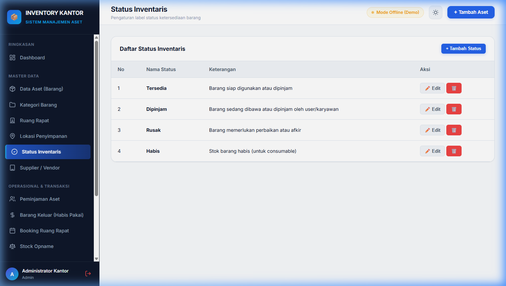
*Gambar 5.6: Master Status Inventaris.*

---

### 5.6 Supplier / Vendor
Buka menu **Master Data &rarr; Supplier / Vendor**. Mendata rekanan penyedia pengadaan dan garansi resmi peralatan kantor.

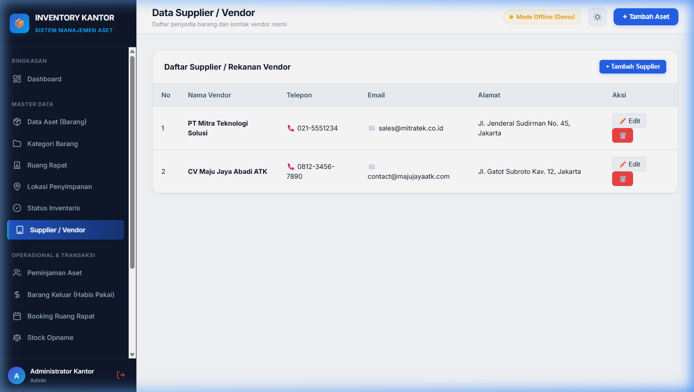
*Gambar 5.7: Master Rekanan Supplier / Vendor.*

---

## BAB VI: OPERASIONAL & TRANSAKSI SIRKULASI

### 6.1 Peminjaman Aset & Pengembalian
Buka menu **Operasional & Transaksi &rarr; Peminjaman Aset**. Digunakan ketika pegawai meminjam peralatan kantor.

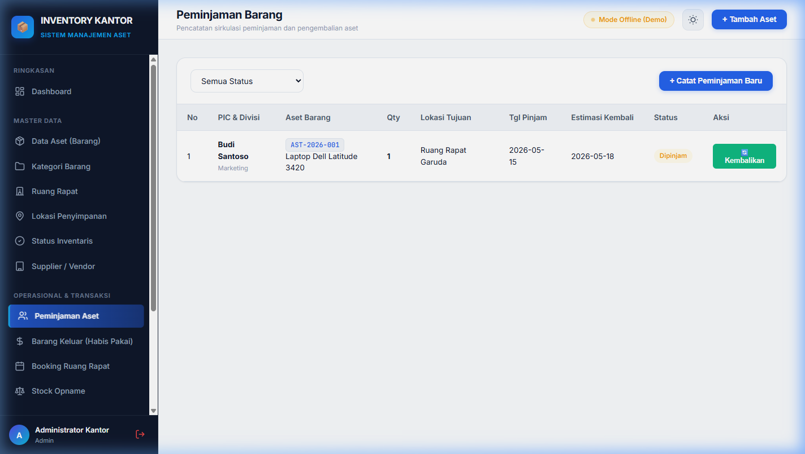
*Gambar 6.1: Daftar Transaksi Peminjaman Aset.*

Klik **+ Pinjam Aset** untuk mencatat peminjaman baru:

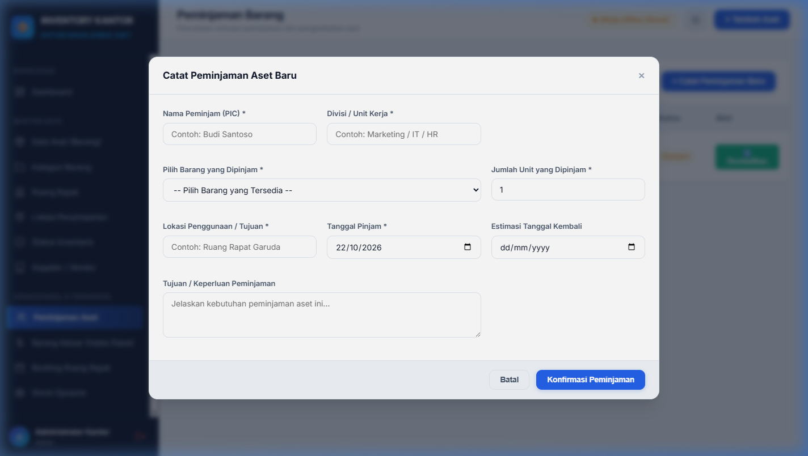
*Gambar 6.2: Form Peminjaman Barang.*

> **Catatan:** Stok fisik barang otomatis berkurang saat peminjaman dicatat, dan otomatis pulih kembali saat tombol **Proses Kembali** diklik oleh petugas.

---

### 6.2 Pengeluaran Barang Habis Pakai (Outbound)
Buka menu **Operasional & Transaksi &rarr; Barang Keluar (Habis Pakai)**. Digunakan untuk mencatat pengeluaran barang ATK yang habis pakai.

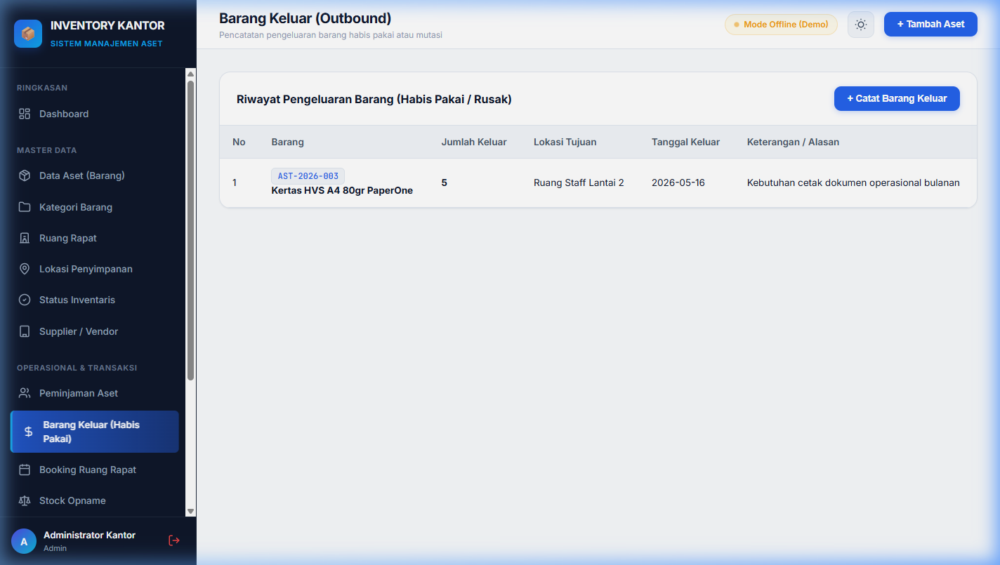
*Gambar 6.3: Log Pengeluaran Barang Habis Pakai.*

---

### 6.3 Booking Ruang Rapat Anti-Bentrok
Buka menu **Operasional & Transaksi &rarr; Booking Ruang Rapat**.

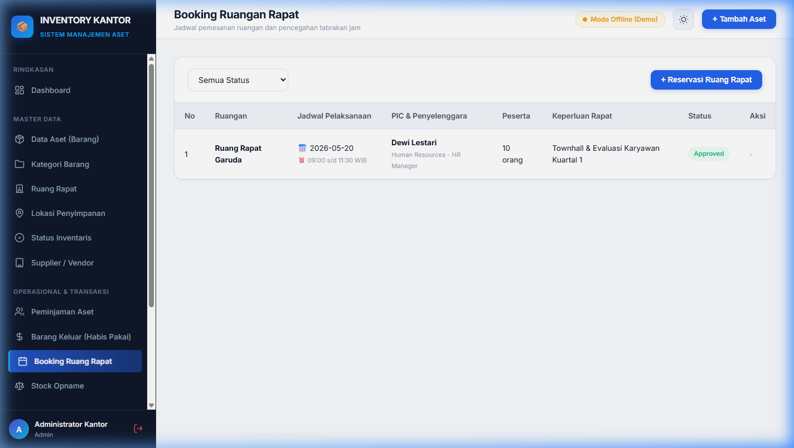
*Gambar 6.4: Jadwal Reservasi Ruang Rapat.*

Klik **+ Booking Ruang Rapat** untuk mereservasi ruangan:

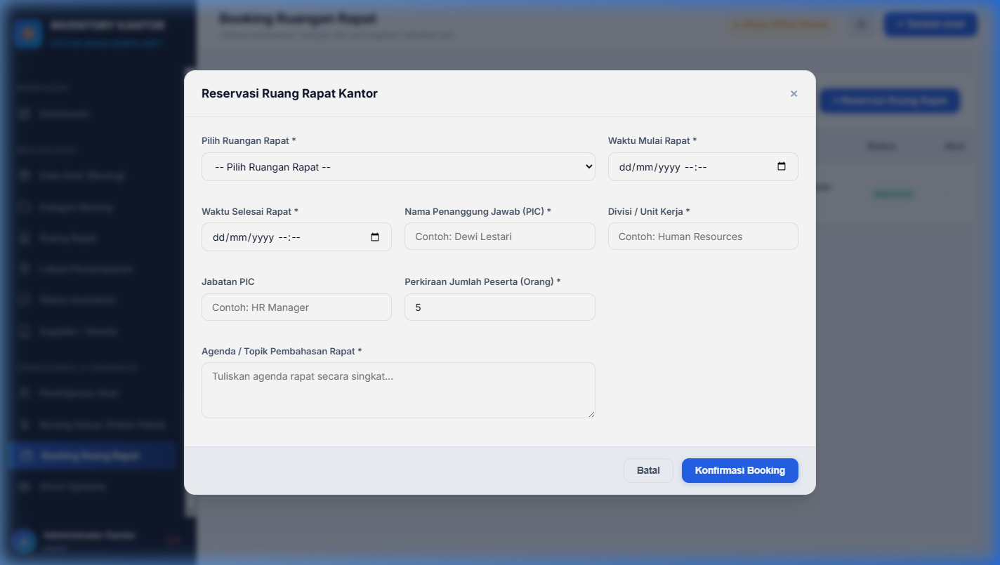
*Gambar 6.5: Dialog Reservasi Ruang Pertemuan.*

> **Live Collision Detection:** Sistem secara otomatis mendeteksi bentrok jam pemakaian. Jika ruangan dan waktu yang dipilih beririsan dengan rapat lain, sistem akan memunculkan peringatan merah dan menolak pendaftaran dobel.

---

### 6.4 Stock Opname (Audit Fisik Berkala)
Buka menu **Operasional & Transaksi &rarr; Stock Opname**. Modul rekonsiliasi berkala stok fisik di gudang dengan catatan sistem.

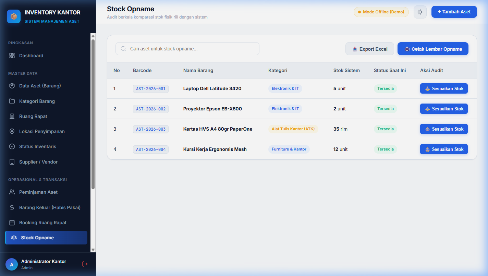
*Gambar 6.6: Modul Audit Stock Opname.*

#### Langkah Audit:
1. Klik tombol **Audit / Cek Fisik** pada barang yang disurvei.
2. Masukkan jumlah fisik riil hasil audit gudang.
3. Sistem secara otomatis menghitung selisih.
4. Tuliskan alasan penyesuaian jika ada selisih fisik (contoh: *Ditemukan 1 unit di lemari belakang*).
5. Klik **Terapkan Penyesuaian Stok**.

---

## BAB VII: PELAPORAN, EKSPOR EXCEL & CETAK DOKUMEN RESMI

Buka menu **Pelaporan & Ekspor &rarr; Laporan & Cetak Dokumen**.

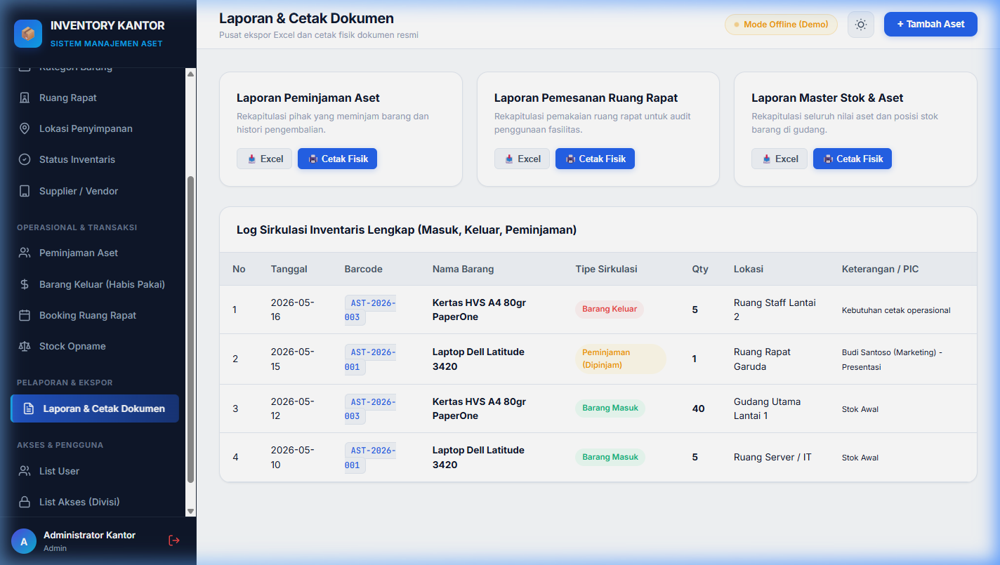
*Gambar 7.1: Pusat Pelaporan & Ekspor Excel.*

### Opsi Pelaporan:
1. **Ekspor Excel (.xls):** Klik tombol **📥 Excel** untuk mengunduh berkas tabel spreadsheet mentah.
2. **Cetak Surat Dinas Resmi:** Klik tombol **🖨️ Cetak Fisik** untuk memunculkan pratinjau surat dinas ber-kop resmi:

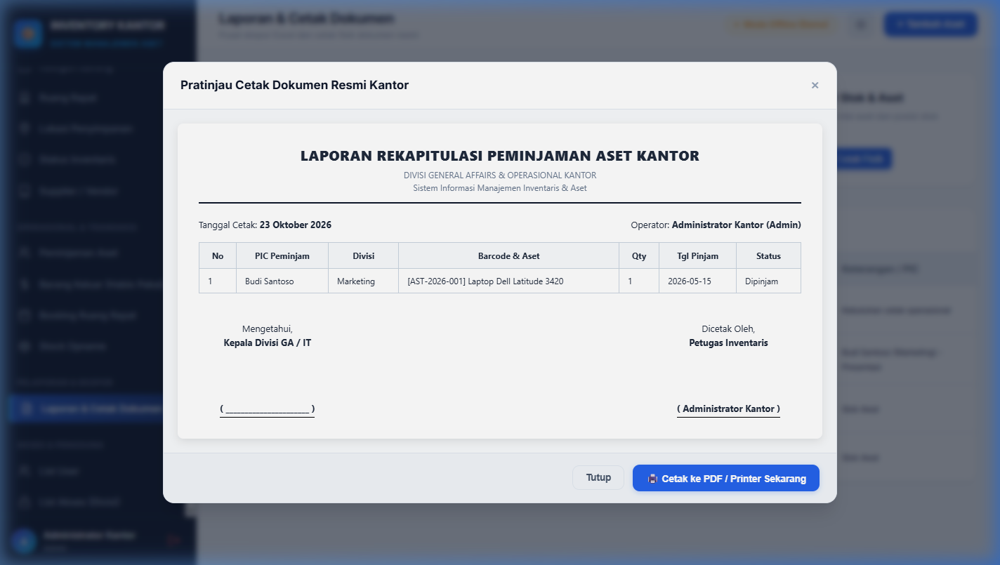
*Gambar 7.2: Pratinjau Cetak Dokumen dengan Kop Surat dan Kolom Tanda Tangan.*

Klik **🖨️ Cetak ke PDF / Printer Sekarang** untuk mencetak ke kertas fisik atau menyimpan berkas dalam format PDF.

---

## BAB VIII: TANYA JAWAB (FAQ) & PANDUAN TROUBLESHOOTING

1. **Bagaimana jika PC staf tidak bisa mengakses web aplikasi?**
   - Pastikan komputer klien dan komputer server berada di jaringan WiFi/LAN kantor yang sama.
   - Periksa IP server (misal: `192.168.1.15:3000`).
   - Pastikan port `3000` pada firewall server diizinkan (Allow Inbound Rules).

2. **Bagaimana jika pegawai berganti divisi?**
   - Masuk ke menu **List User** &rarr; klik **Edit** pada akun staf &rarr; ubah dropdown **Pilih Divisi & Level Hak Akses** &rarr; Simpan. Seluruh izin menu staf tersebut akan otomatis berganti mengikuti divisinya yang baru.

3. **Apakah data aman jika server mati mendadak?**
   - Seluruh data transaksi tersimpan permanen di database MySQL dengan struktur relasional yang terproteksi integritasnya.
